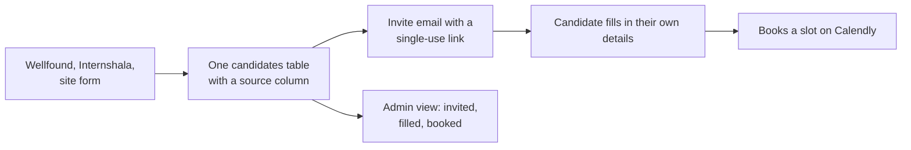

# ZERO hiring platform: case study
 
The hiring platform I built in under a week for ZERO, my own startup, and the round I ran on it in July and August 2026. ZERO is paused as of November 2026. The code stays private because it holds applicants' data. This repo explains what I built and why.
 
**Outcome:** 401 applications, 104 take-home builds reviewed, 90+ interviews in three weeks, 8 founding builders hired. One person ran the whole round.
 
**Stack:** Next.js, TypeScript, Supabase (Postgres with row-level security), Resend, Calendly, Vercel, Cloudflare DNS.
 
---
 
## The problem
 
Applications were arriving from Wellfound, Internshala and the company's own form, each in a different shape. The only person running hiring was the founder, so founder time was the constraint, not tooling.
 
## The design
 

 
- **One table for every source.** Every candidate lands in the same shape, whichever platform they came from.
- **Candidates fill in their own details.** This was the load-bearing decision. Platforms change their notification templates; parsing them breaks. Asking the candidate is simpler and never breaks.
- **Details are saved before booking,** so a candidate who drops off at the calendar is still captured.
- **A single-use link per candidate,** so a forwarded URL can't take someone else's interview slot.
- **Row-level security:** an applicant can write their own row and read nobody else's.
## What I deliberately did not build
 
Inbox parsing of platform emails, Calendly webhooks, a second confirmation email (Calendly sends one) and automated rejections (rejections stayed human). Every extra hop is a place a candidate drops off.
 
## What I'd do next
 
A status page for candidates, so nobody has to email to ask where they stand.
 
---
 
Built by [Pari Goyal](https://founder.zero4genz.in).
 
